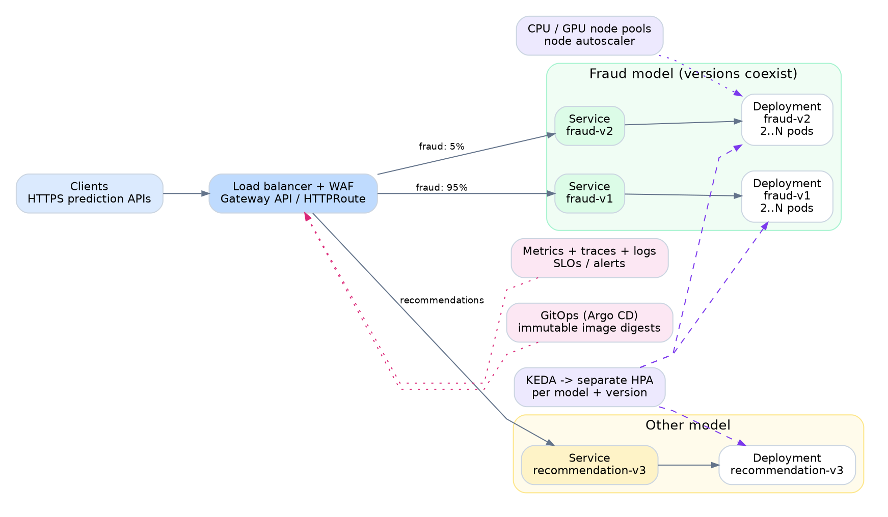
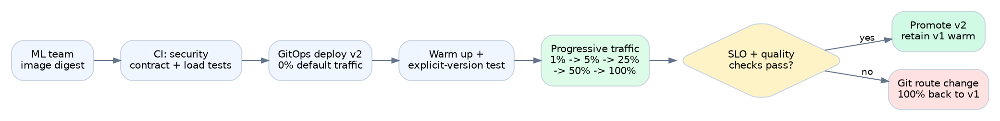

# Scalable, reliable multi-model inference platform

**Senior SRE / DevOps–MLOps design exercise**

## Design
```
Run each `(model, version)` as an independently managed, autoscaled Kubernetes Deployment; expose each through a Service; use a Gateway API route for explicit version access and weighted traffic to the default version; deliver everything by GitOps with observability and automated release gates.
```

## 1. Scope and assumptions

The ML team supplies an OCI/Docker image that starts an HTTP inference server. We need to host many models, allow concurrent versions, and scale each one independently. The initial platform serves synchronous HTTP predictions within a single region; the same model can run on CPU or GPU depending on its declared requirements. The platform supports stateless inference and does not assume a single universal JSON prediction schema.

Each image must have a small deployment contract: image digest, container port, prediction path, liveness/readiness paths, expected input/output compatibility, resource profile, maximum safe concurrency, and graceful shutdown behavior. If a team cannot meet the health/telemetry contract, a small sidecar or adapter can provide it. Routes may rewrite the public path to each model's actual path. Different API schemas or breaking model versions require explicit version selection, not blind weighted routing.

Illustrative targets - not measured promises: 99.9% monthly request availability for tier-1 models; p95 latency target agreed per model (e.g. 300 ms for a lightweight CPU model); RTO 30 minutes and RPO approximately zero for declarative platform configuration. Decide real SLOs using load tests, error budgets and business requirements.

## 2. Architecture



The core units are independent:

| Object | Responsibility | Isolation boundary |
|---|---|---|
| **Deployment per model version** | Run the pinned image digest and its resources/probes | `fraud-v1`, `fraud-v2`, `recommendation-v3` |
| **ClusterIP Service per version** | Stable DNS and ready endpoint selection | `fraud-v1-svc`, `fraud-v2-svc` |
| **KEDA ScaledObject per version** | Drive its own HPA from demand metrics | Separate min/max replicas and scaling thresholds |
| **Gateway API HTTPRoute per model** | Route default traffic by weight and provide explicit version URLs | Change traffic without restarting models |
| **Node provisioning** | Add CPU or GPU nodes when pods cannot schedule | Separate instance families, quotas and budgets |

**Request path.** A client calls `POST /models/fraud/predict` over HTTPS. The cloud load balancer/WAF, identity proxy and Gateway-controller policies enforce authentication, rate limits, body-size limits and timeouts; these policies are implementation-specific, not all core HTTPRoute features. An HTTPRoute splits requests (for example 95% to `fraud-v1-svc`, 5% to `fraud-v2-svc`). For reproducibility and clients requiring a fixed release, `POST /models/fraud/versions/v2/predict` targets v2 directly. The gateway can rewrite paths to the configured internal inference endpoint. The model container responds; the gateway records the selected backend, status and latency. Route names and model/version values come from an approved registry, never from arbitrary user input.

**Infrastructure example.** AWS EKS across three availability zones, a managed public load balancer with TLS/WAF, a Gateway API-compatible controller (e.g. NGINX Gateway Fabric), private ECR, and CPU/GPU node pools provisioned by Karpenter. This is a deployable reference choice, not a requirement for AWS: the same topology works with GKE/AKS and equivalent components.

**Why not a single Deployment for a model?** Multiple versions in one Deployment cannot have different resource requests, rollout lifecycles or HPA decisions. Even if they share one GPU or node pool, Kubernetes must be able to scale the **version** independently. For hot paths we keep at least two ready replicas per production version; preproduction or dormant versions may use smaller minimums, but scaling to zero is avoided for latency-sensitive synchronous APIs because cold starts can take minutes.

## 3. Reliability, resilience and security

- **Zone and node failures:** replicas preferentially distributed with topology spread rules and pod anti-affinity, with strict zone-spread plus capacity reservations where required; at least two ready pods for tier-1 versions; PodDisruptionBudgets for planned evictions; capacity reserved for one-zone disruption where the SLO requires it. Managed control plane; no single cluster node is critical.
- **Safe startup and termination:** `startupProbe` tolerates model loading, `readinessProbe` only succeeds when weights are loaded and warm-up passes, `livenessProbe` detects deadlock; rolling Deployment settings and `preStop`/termination grace let in-flight requests drain. Never send canary traffic before ready replicas are available.
- **Overload control:** per-tenant rate limits, bounded model concurrency, ingress deadlines, request-size limits and explicit `429/503` when saturated. Retry only safe/idempotent requests, with budgets and jitter. No unbounded queue; for long-running inference add a separate asynchronous job API with durable queue and worker scaling.
- **Failure isolation:** resource requests/limits, separate CPU/GPU pools, dedicated namespaces and RBAC/quotas for teams, NetworkPolicies, HPA max bounds and quota-based guardrails. Bad model versions can be routed to weight zero without affecting others.
- **Security:** images pinned by immutable digest, image scanning and signing/verification, workload identity instead of credentials in images, secrets via managed secret store, private nodes/registry, minimal container permissions, TLS in transit, encryption at rest and restricted egress. Prediction payloads are **not** logged by default.
- **Disaster recovery:** configuration in version-controlled Git, registry replication/backups where needed, cluster/IaC reproducibility, regular recovery drills. Multi-region active/active is a later business decision if regional RTO/RPO requirements justify the added cost/complexity.

## 4. Independent autoscaling and capacity

For each `(model, version)` define a KEDA `ScaledObject` that produces a separate HPA target. A useful baseline signal is **requests per second routed to that backend**, from gateway metrics with **bounded labels** (`model`, `version`), not the combined model endpoint. Tune per-version target RPS per replica using realistic production-like load tests. For example, if a v2 replica safely sustains **20 RPS** at its p95 latency SLO, 120 RPS routed to v2 implies roughly **six pods** before headroom (subject to HPA smoothing, capacity limits and minimums).

For models with variable inference duration or GPU bottlenecks, use concurrency/queue depth and GPU utilization as additional signals **after validating their semantics**; CPU alone can miss GPU saturation. KEDA queries need known working telemetry; a missing query is an incident, not an instruction to scale down. Use minimum warm replicas, rate-based scale-up, slower scale-down, and pre-scale ahead of launches. The node autoscaler must also have available capacity; GPU procurement and model loading are often slower than the HPA cycle.

One important tradeoff: canary v2 initially receives little or no traffic, so demand metrics may not scale it ahead of a routing change. First create and warm v2 with an explicit minimum replica count, validate it, then increase traffic incrementally. Reserve headroom before steps. Keep minimum replicas for the old version until the rollback window closes.

**Illustrative workload configuration:** see [`examples/`](examples/README.md). The sample uses two Deployments, two Services, independent KEDA autoscalers and weighted `HTTPRoute`, with an intentionally illustrative metric and image digest that must be replaced before deployment.

## 5. Infrastructure toolkit

| Layer | Selection | Why / responsibility |
|---|---|---|
| Foundation | **Terraform** + remote state, locking, CI plan approval | VPC, IAM, EKS, registry, DNS, load balancer prerequisites, monitoring storage; reviewable changes |
| Platform | **Helm** + **Argo CD** | Version and reconcile Gateway controller, KEDA, Karpenter, OpenTelemetry collectors, metrics components |
| Model releases | **Git + Kustomize/Helm** + **Argo CD** | Immutable image digest, resources, health contract, Services, autoscalers, routes in declarative manifests |
| Container CI | **GitHub Actions** (or GitLab CI) | Contract test, vulnerability scan, sign, integration/performance tests, PR to deployment repo |
| Traffic control | **Gateway API HTTPRoute** | Explicit version access and stable/weighted routing without application redeploy |
| Secrets/policy | **Cloud IAM + External Secrets + admission policy** | Least privilege, image/provenance enforcement, safe tenancy |

**Ownership boundary:** Terraform defines cloud foundation. Argo CD owns cluster objects and model deployments. Do not let Terraform, Argo CD and manual `kubectl apply` fight over the same resource. Pin all versions; use separate dev/staging/prod environments and protected review for production. The registry and deployment Git repository are the model release catalog; a dedicated ML model registry is optional and not needed for the requirements stated.

## 6. Monitoring, observability and SLOs

Use **Prometheus** for metrics, **Grafana** for dashboards, **OpenTelemetry** for traces, and a centralized log backend (e.g. Loki or managed cloud logs). Export metrics at the Gateway and model pod. Maintain dashboards at **platform**, **model** and **model-version** level. Keep metric labels low-cardinality; never label by request ID, user ID or raw URL.

| Signal | What to monitor | Action |
|---|---|---|
| User experience | request rate, success/error rates, p50/p95/p99 end-to-end latency, 429/503, timeouts by model/version | Multi-window SLO burn-rate paging |
| Version health | readiness, restarts, OOM, crash loops, prediction errors, response/schema validation failures | Freeze/rollback the version |
| Scaling | desired/ready pods, HPA saturation/max, KEDA metric errors, pending pods, node provisioning delay | Raise capacity, fix telemetry or quotas |
| Model efficiency | active inference requests, queue wait, GPU memory/utilization, CPU/memory, model loading time | Tune limits, batch/concurrency or node types |
| Release safety | version traffic split vs expected, request success by backend, error budget consumed | Stop promotion and revert routing weights |

Each request gets a trace ID and spans for Gateway/routing/model execution (where supported), plus structured logs with `model`, `version`, `trace_id`, request duration, status and relevant non-sensitive error class. Add synthetics that call representative inference inputs against the *stable* and *explicit version* endpoints from outside the cluster. Critical alerts should be actionable and linked to runbooks. **Model quality/drift** (accuracy, data drift, fairness) belongs primarily to ML/product ownership, with an SRE integration point for gating risky rollouts.

## 7. Release and operations



**Release a new model version (e.g. fraud v2):**

1. **Validate artifact:** ML publishes image; CI checks signature, scans dependencies, verifies the endpoint/probe contract and input/output schema compatibility, runs representative smoke and load tests, and pins the image by digest in a pull request.
2. **Deploy dark:** Argo CD syncs `fraud-v2` Deployment + Service + its **own** KEDA scaler in staging, then production at **0% default traffic**. Keep explicit `/versions/v2/` test access, pre-warm model weights and validate readiness.
3. **Progressively route:** a protected deployment pipeline updates the Git-managed HTTPRoute to **1% → 5% → 25% → 50% → 100%**, observing sufficient requests and a minimum analysis window at each step. Sample percentages are a policy, not an automated timer.
4. **Evaluate and promote:** compare v2 and v1 success rates, latency distributions and saturation at meaningful sample sizes; inspect quality guardrails from ML. Automatically stop/rollback on SLO regression, 5xx spikes, failed probes or an operator veto.
5. **Keep rollback ready:** preserve v1 pods/Service for a rollback window. To revert, **commit a new Git change** setting v1 to 100%, v2 to 0% (a direct Argo CD history rollback conflicts with auto-sync). If serving changes break API compatibility, roll back the client/schema too.
6. **Retire deliberately:** after the agreed observation window, remove unused versions, Route rules and HPA/ScaledObjects by reviewed Git change, checking who still uses version-pinned URLs first.

**Infrastructure change:** Terraform plan → peer review/security checks → staging apply → production apply in a maintenance/change window if necessary; roll cluster changes and addons one at a time, verify PDB/node capacity and control plane compatibility. For EKS node upgrades use managed rolling nodes and drain rules, test cold-start and node-loss behavior, and have a tested rollback or rebuild strategy. Critical data-plane changes are canaried separately.

**Incident example:** v2 causes 5xx spikes at 25%: the alert pages on-call, promotion halts, route weights revert via an emergency approved Git PR to 100% v1; since v1 replicas remain warm, traffic can resume without waiting for a model pull. Review request traces and ML output validation, then repair and re-test v2. If GitOps reconciliation itself is impaired, an emergency route patch is allowed under break-glass policy, recorded and immediately reconciled back into Git to avoid drift.

## 8. Decisions, tradeoffs and follow-up questions

- **Kubernetes versus managed model serving:** Kubernetes fits the image-first requirement and independent per-version controls. Managed services (e.g. SageMaker endpoints) reduce platform toil but constrain routing/runtime and may be preferable if the team wants minimal Kubernetes operations.
- **No service mesh initially:** Gateway API is enough for edge routing. Add a mesh only if internal traffic authorization, mTLS and cross-service policies demand it.
- **RPS scaling is a baseline, not universal:** variable request cost, high-memory/GPU models and long inference times require profile-specific limits and scaling signals. Don't promise scale-to-zero with strict synchronous latency.
- **Traffic weights do not guarantee exact request mix:** a low-volume canary needs minimum sample sizes and may require shadow/replay traffic. Mirroring real payloads must comply with privacy policy and should not have user-visible side effects.
- **Failure modes to test before go-live:** single node/AZ loss, registry outage, image pull slowness, failed metrics pipeline, gateway failure, quota exhaustion, traffic spike, and rollback under load.

**Questions to resolve with the business/ML team:** What are p95 latency/SLOs per model? How many models/versions, QPS, payload sizes and GPU requirements? Are requests idempotent? Must schemas remain backward compatible? Can traffic leave the region? What are spend caps and retention requirements? Which clients rely on pinned versions? These answers set the guardrails, not the basic isolation architecture.

## 9. References

Official references used:

- Kubernetes Gateway API traffic splitting: https://gateway-api.sigs.k8s.io/guides/user-guides/traffic-splitting/
- Kubernetes Gateway API request rewrites (controller support varies): https://gateway-api.sigs.k8s.io/guides/user-guides/http-redirect-rewrite/
- Kubernetes HPA: https://kubernetes.io/docs/concepts/workloads/autoscaling/horizontal-pod-autoscale/
- KEDA Prometheus scaler: https://keda.sh/docs/2.21/scalers/prometheus/
- KEDA ScaledObject spec: https://keda.sh/docs/2.21/reference/scaledobject-spec/
- Kubernetes topology spread: https://kubernetes.io/docs/concepts/scheduling-eviction/topology-spread-constraints/
- Argo CD auto-sync behavior: https://argo-cd.readthedocs.io/en/latest/user-guide/auto_sync/
- OpenTelemetry HTTP metrics: https://opentelemetry.io/docs/specs/semconv/http/http-metrics/
- Karpenter GPU scheduling: https://karpenter.sh/docs/concepts/scheduling/

